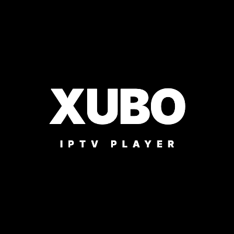

<p align="center">
  
</p>

<h1 align="center">XUBO IPTV Player</h1>

<p align="center">
  <b>Android TV, Google TV, Samsung Smart TV (Tizen) ve LG Smart TV (webOS) için tasarlanmış yeni nesil, yüksek performanslı ve akıcı IPTV oynatıcısı.</b>
</p>

<p align="center">
  <a href="https://github.com/umurcelebi/xubo/releases/latest"></a>
  
  
  <a href="https://umurcelebi.github.io/xubo/privacy.html"></a>
</p>

---

## 📌 Hızlı Bağlantılar

- 🚀 **[En Son Sürümü İndir (Releases)](https://github.com/umurcelebi/xubo/releases)**
- 🌐 **[Resmi Web Sitesi & Tanıtım](https://umurcelebi.github.io/xubo/)**
- ⚡ **[Doğrudan İndirme Sayfası](https://umurcelebi.github.io/xubo/indir.html)**
- 🔒 **[Gizlilik Politikası](https://umurcelebi.github.io/xubo/privacy.html)**

---

## ✨ Öne Çıkan Özellikler

- 📺 **Akıllı Canlı TV & EPG:** Hızlı kanal geçişleri, canlı kanal önizlemesi ve elektronik program rehberi (EPG) desteği.
- 🎬 **VOD & Dizi Modülü:** Sezon ve bölüm gezintisi, IMDb puanları, oyuncu kadrosu, tür filtreleri ve akıllı sıralama.
- ⏯️ **Kaldığın Yerden Devam Et & Canlı İzlendi Rozetleri:** İzlenen film ve bölümler anında `✓` rozetiyle işaretlenir, menü değiştirmeden senkronize olur.
- 🔄 **Google Drive & SyncStore Eşitleme:** Favorileriniz, izleme geçmişiniz ve hesap ayarlarınız güvenle bulutta yedeklenir; cihazlar arasında tek dokunuşla eşitlenir.
- 👨‍👩‍👧‍👦 **Çoklu Profil & Çocuk Modu:** Aile bireyleri için bağımsız profiller ve yetişkin içeriklerini gizleyen 4 haneli PIN korumalı Çocuk Kilidi.
- 🎮 **Tam Uzaktan Kumanda Uyumu (Spatial Nav):** TV kumandası D-Pad tuşlarıyla kusursuz gezinme, akıllı odak hafızası ve sanal liste optimizasyonu.
- 🔆 **Gelişmiş Jest ve Oynatıcı Kontrolleri:** Mobil ve TV ekranlarında pürüzsüz parlaklık/ses jestleri, çoklu ses ve altyazı seçimi.

---

## 📥 Kurulum (Android TV & Google TV)

### Yöntem 1: Downloader Uygulaması ile (En Kolay)
1. TV'nizin Google Play Store mağazasından ücretsiz **Downloader by AFTVnews** uygulamasını yükleyin.
2. Downloader arama çubuğuna şu adresi girip **Go** butonuna basın:
   ```text
   https://umurcelebi.github.io/xubo/downloads/xubo-iptv.apk
   ```
3. İndirme tamamlandığında **Install (Yükle)** seçeneğini onaylayarak kurulumu tamamlayın.

### Yöntem 2: GitHub Releases ile Doğrudan İndirme
- Bilgisayarınızdan veya cihazınızdan [Releases](https://github.com/umurcelebi/xubo/releases) sayfasına giderek en güncel `XUBO-IPTV-x.x.x.apk` paketini doğrudan indirin.
- Bir USB bellek veya dosya yöneticisi yardımıyla TV'nize kurun.

---

## 📱 Desteklenen Platformlar

| Platform | İşletim Sistemi | Kurulum Dosyası | Durum |
| :--- | :--- | :--- | :--- |
| **Android TV / Google TV** | Android 6.0 ve üzeri | `.apk` | ✅ Yayında (Kararlı) |
| **Android Mobil / Tablet** | Android 6.0 ve üzeri | `.apk` | ✅ Yayında (Kararlı) |
| **Samsung Smart TV** | Tizen OS 4.0 ve üzeri | `.wgt` | 🚀 Özel DUID / Beta |
| **LG Smart TV** | webOS 4.0 ve üzeri | `.ipk` | 🚧 Geliştirme Aşamasında |
| **iOS (iPhone & iPad)** | iOS 16 ve üzeri | App Store | ⏳ Planlandı |
| **Apple TV (tvOS)** | tvOS 16 ve üzeri | App Store | ⏳ Planlandı |

---

## 🛡️ Güvenlik & Doğrulama

Her sürüm, bütünlüğü ve güvenliği doğrulamak adına SHA-256 kriptografik özeti ile birlikte yayınlanır. Son sürümün doğrulaması:

- **Paket Adı:** `com.xubo.iptv`
- **Son Sürüm:** `v1.2.2 (Build 146)`
- **SHA-256:** `1391db0c770e016de306f5912e48edd32513ead6213caec6c5b5e49c2360671e`

---

## ⚠️ Yasal Uyarı (Disclaimer)

*XUBO IPTV Player, bağımsız bir medya oynatıcı istemcisidir. Uygulama içerisinde hiçbir şekilde canlı yayın, film, dizi, m3u çalma listesi veya telif hakkına tabi medya içeriği barındırılmaz ve sağlanmaz. Kullanıcılar, yalnızca kendilerine ait yasal IPTV sağlayıcı bilgilerini veya halka açık yayın kaynaklarını ekleyerek uygulamayı kullanırlar.*

---

<p align="center">
  Geliştirici: <b>Umur Çelebi</b> • © 2026 XUBO Media. Tüm hakları saklıdır.
</p>
